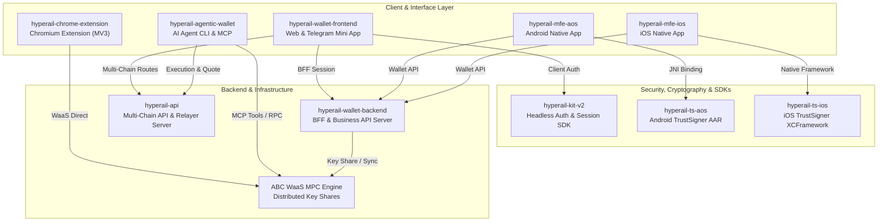

# Welcome to Hyperail 👋

> **Next-Generation Multi-Chain Web3 Wallet & Autonomous Agent Financial Infrastructure**  
> Non-Custodial • MPC-Powered • Multi-Platform • AI Agent Native

---

## 🌟 About Hyperail

**Hyperail** is an enterprise-grade multi-chain Web3 wallet and autonomous AI financial infrastructure suite. Designed from the ground up for seamless asset management, high security, and programmatic on-chain operations, Hyperail bridges the gap between everyday crypto users and autonomous AI agents.

From consumer-facing web, mobile, and browser extension interfaces to native whitebox cryptographic engines and Model Context Protocol (MCP) servers, Hyperail delivers a unified, zero-compromise non-custodial experience.

---

## 🏗️ System Architecture

---

## 📦 Core Ecosystem Repositories

| Repository | Role & Layer | Primary Tech Stack |
|---|---|---|
| [**`hyperail-wallet-frontend`**](https://github.com/hyperail/hyperail-wallet-frontend) | Responsive Web Wallet & Telegram Mini App | Next.js (Pages), React 18, Tailwind, TypeScript |
| [**`hyperail-chrome-extension`**](https://github.com/hyperail/hyperail-chrome-extension) | Standalone Chrome Extension Wallet | Vite 6, React 18, TypeScript, Manifest V3 |
| [**`hyperail-wallet-backend`**](https://github.com/hyperail/hyperail-wallet-backend) | Wallet API, Indexing & BFF Server | Express, TypeScript, TypeORM, PostgreSQL, Redis |
| [**`hyperail-api`**](https://github.com/hyperail/hyperail-api) | Multi-Chain Swap, Relayer, Risk & Protocol API | NestJS 10.4, TypeScript 5, Prisma 7, PostgreSQL, Redis |
| [**`hyperail-agentic-wallet`**](https://github.com/hyperail/hyperail-agentic-wallet) | Autonomous AI Agent CLI & MCP Server | TypeScript, tsup, viem v2, Commander, MCP SDK |
| [**`hyperail-kit-v2`**](https://github.com/hyperail/hyperail-kit-v2) | Headless Auth & Zero-Storage Session SDK | TypeScript, React, Vite, Playwright |
| [**`hyperail-mfe-aos`**](https://github.com/hyperail/hyperail-mfe-aos) | Native Android Mobile Wallet App | Kotlin/Java, Gradle 8.9, AGP 8.6.1, Hilt, Realm |
| [**`hyperail-mfe-ios`**](https://github.com/hyperail/hyperail-mfe-ios) | Native iOS Mobile Wallet App | Swift 5.0, Xcode workspace, CocoaPods |
| [**`hyperail-ts-aos`**](https://github.com/hyperail/hyperail-ts-aos) | Android Native Cryptographic Module (AAR) | C++17, JNI, NTL 9.6.2, Boost 1.68, CMake, NDK 28 |
| [**`hyperail-ts-ios`**](https://github.com/hyperail/hyperail-ts-ios) | iOS Native Cryptographic Framework (XCFramework) | C++17, Swift, NTL 9.6.2, Boost 1.69, Clang++ |
| [**`hyperail-devops`**](https://github.com/hyperail/hyperail-devops) | Deployment Orchestration & Reverse Proxy | Docker Compose v2, Caddy, PostgreSQL 17, Redis |

---

## ⚡ Key Capabilities

### 🌐 Multi-Chain Ecosystem
- **EVM Networks**: Ethereum, Arbitrum, Polygon, BSC, Kaia, and custom EVM chain integration.
- **Non-EVM Networks**: Bitcoin (SegWit/Taproot), Solana, Tron, and Hyperliquid.
- **Cross-Chain Interoperability**: Seamless asset transfers powered by Circle CCTP, LayerZero, and Wormhole.

### 🔐 Enterprise-Grade Non-Custodial Security
- **MPC Architecture**: Multi-Party Computation eliminates single points of failure. Users never expose raw seed phrases.
- **Hardware & Whitebox Cryptography**: Native TrustSigner engines on Android (AAR) and iOS (XCFramework) enforce BIP-32/BIP-39 HD key derivation and fail-closed cryptographic entropy.
- **Zero-Storage Session SDK**: `hyperail-kit-v2` operates strictly via same-origin BFF HTTP-only cookie sessions without storing tokens in client storage.
- **Supply-Chain & Runtime Guards**: Native runtime loaders implement symlink rejection guards, and frontend web applications enforce strict Content Security Policies (CSP) with fail-closed iframe origin validation.

### 🤖 Autonomous AI Agent Infrastructure
- **Agentic Wallet & MCP Server**: Direct integration with AI agent workflows via the Model Context Protocol (MCP).
- **Automated Trading & Staking**: Programmatic trading on Hyperliquid (perps/spot), Polymarket prediction markets, and Arcus orderbooks.
- **Gasless Transactions**: Native support for EIP-7702 account abstraction and gasless relayers.

### 🔄 Integrated DeFi & Gamification
- **DEX Aggregation**: Multi-route swaps powered by 1inch (EVM) and Jupiter (Solana).
- **Liquid Staking**: Built-in staking workflows for Lido (stETH/wstETH), KAIA (Kommune), and StakeWeight.
- **Gamified Rewards & Quests**: Faucet, daily roulette, prediction challenges, and leaderboard point systems.

---

## 🔒 Security & Code Quality Standards

Every repository in the Hyperail organization adheres to strict engineering guidelines:
- **Zero Critical/High Vulnerabilities**: Clean dependency audits across NPM, Maven, and CocoaPods graphs.
- **Sanitized Git History**: Permanent elimination of hardcoded credentials, test seeds, and sensitive RPC keys.
- **Strict Testing Gates**: Comprehensive unit, integration, and offline test suites across all layers.

---

## 📬 Contact & Community

- **GitHub**: [github.com/hyperail](https://github.com/hyperail)
- **Organization**: Hyperail Team
- **License**: Proprietary / MIT (per component license declarations)
